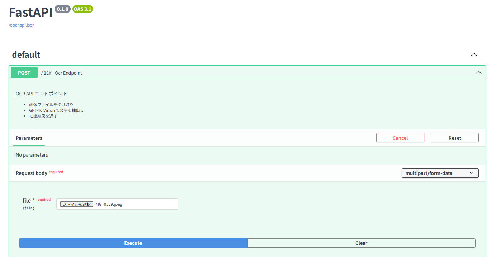
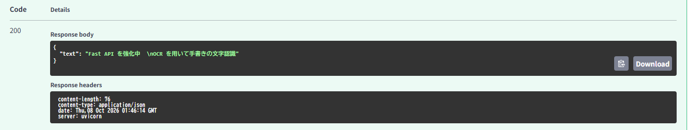
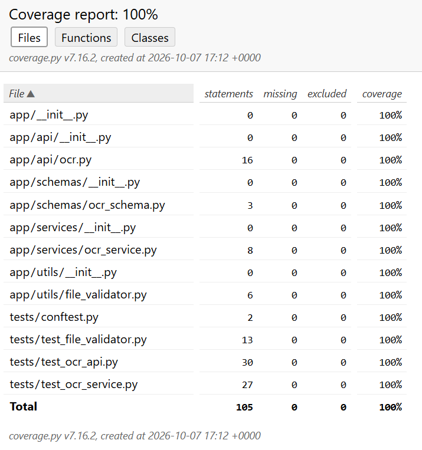

# OCRを用いた画像文字認識API

## 概要
画像ファイルをアップロードして、OpenAI の Vision モデルを使い文字を抽出する FastAPI アプリケーションです。
このプロジェクトは、画像内のテキストを OCR で読み取り、結果を JSON で返す API を提供します。
手書きの文字にも対応します。

- FastAPI を使った REST API
- 画像アップロード対応
- JPEG / PNG のみ対応
- GPT-4o-mini を使用した文字抽出

## アプリケーション画面

### Swagger UI



### OCR 実行結果



## 技術スタック

- Python 3.11
- FastAPI
- OCR（OpenAI GPT-4o-mini Vision）
- OpenAI Python SDK
- Poetry
- pytest / coverage
- Docker / Docker Compose

## ディレクトリ構成

```text
image_ocr_app/
├── app/
│   ├── api/
│   │   └── ocr.py
│   ├── schemas/
│   │   └── ocr_schema.py
│   ├── services/
│   │   └── ocr_service.py
│   ├── utils/
│   │   └── file_validator.py
│   └── main.py
├── tests/
│   ├── conftest.py
│   ├── test_file_validator.py
│   ├── test_ocr_api.py
│   └── test_ocr_service.py
├── .env
├── Dockerfile
├── docker-compose.yml
├── pyproject.toml
├── poetry.lock
└── README.md
```

## 必須環境

- Python 3.11 以上
- OpenAI API キー
- Poetry

## セットアップ

1. 依存関係をインストールします。

```bash
poetry install
```

2. 環境変数を設定します。 `.env` ファイルを作成し、以下を記載してください。

```env
OPENAI_API_KEY=your_openai_api_key
```

3. アプリケーションを起動します。
```bash
docker compose up --build
```

## API 使用方法

### OCR 実行

```bash
curl -X POST "http://localhost:8000/ocr" \
  -F "file=@/path/to/sample.png"
```

### レスポンス例

```json
{
  "text": "抽出された文字列"
}
```

## サポート対象ファイル

以下の形式のみ受け付けます。

- .jpg
- .jpeg
- .png

MIME Type と拡張子の組み合わせが一致しない場合、400 エラーになります。

## テスト

```bash
poetry run pytest --cov=app --cov-report=term-missing
```

テストカバレッジ 100% を達成しています。



## 補足

- 画像ファイルの検証は `app/utils/file_validator.py` で行っています。
- OCR 処理本体は `app/services/ocr_service.py` に実装されています。
- API エンドポイントは `app/api/ocr.py` で定義されています。